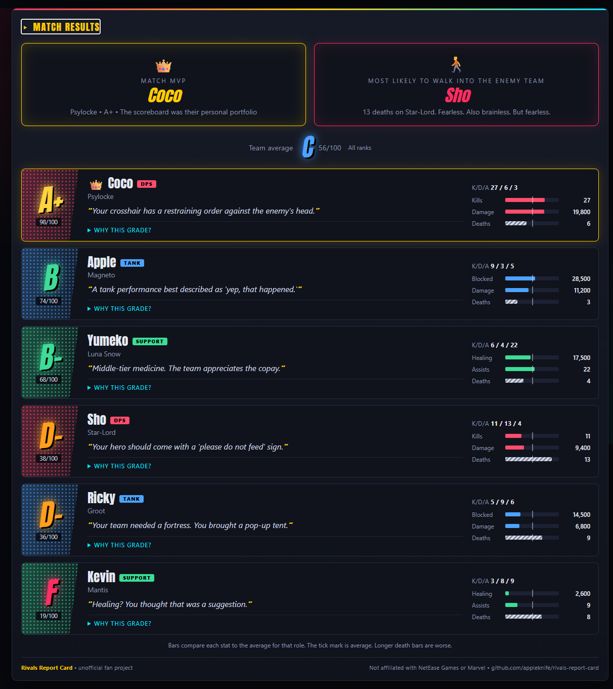
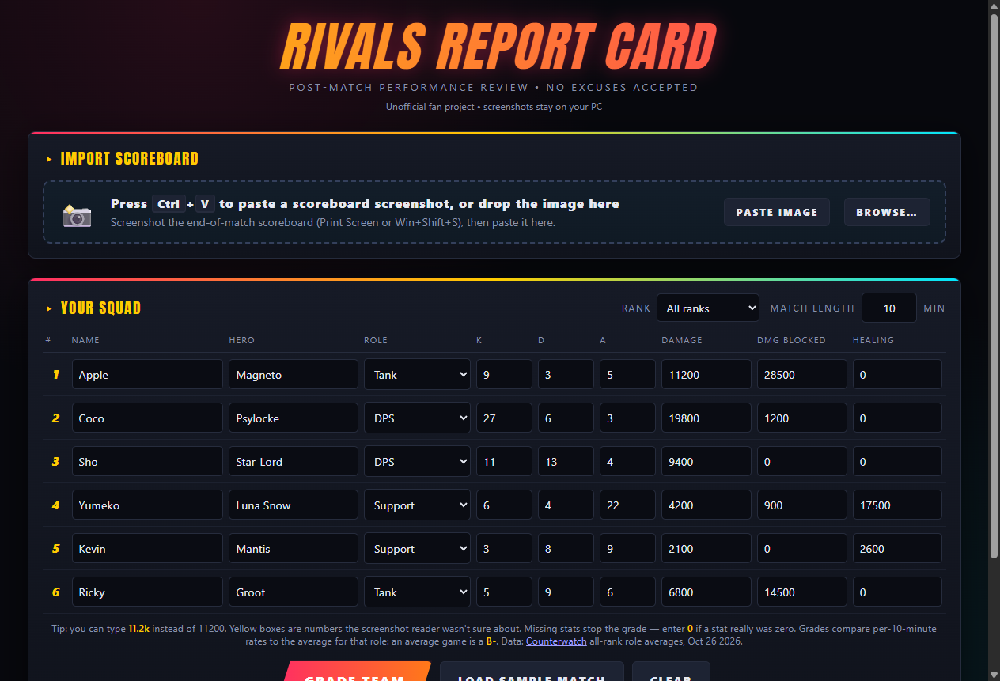

# Rivals Report Card

Paste a Marvel Rivals end-of-match scoreboard screenshot, and Rivals Report Card grades everyone on your team from A+ to F, roasts the feeders, crowns an MVP, and gives you an image to drop into Discord.

It's a Windows desktop app that runs fully offline. The screenshot is read on your own PC and never uploaded. The app does not collect anything or talk to a server.

> Unofficial fan project. Not affiliated with or endorsed by NetEase Games or Marvel. Marvel Rivals and related names are trademarks of their respective owners.



## Install

1. Download `Rivals-Report-Card-Windows.zip` from the [Releases](../../releases) page.
2. Unzip it, open the folder and run **Rivals Report Card.exe**. Keep the .exe in that folder, since it needs the files next to it.
3. Windows will probably show "Windows protected your PC" because the app isn't code-signed. Click **More info**, then **Run anyway**. You only need to do this once.

## How to use it

1. At the end of a match, screenshot the scoreboard with **Print Screen** or **Win+Shift+S**.
2. In the app, press **Ctrl+V**. You can also drag an image file onto the window or click **Browse…**.
3. The app fills in names, roles, K/D/A, damage, damage blocked, healing and match length for your team (the top six rows). Boxes highlighted in yellow are values it wasn't sure about, so check those.
4. Add heroes if you like, then click **Grade Team**. If a stat is blank, the app asks you to fill it in rather than assuming zero; enter `0` if it really was zero.
5. Click **Copy image** and paste the results anywhere with Ctrl+V, or click **Save image**. Turn on **Nice mode** for gentler lines, or **Hide names in image** to share without player names.

You can also type stats in by hand. `11.2k`, `11 200` and `11,200` all work, and Enter jumps to the next box. The **Paste image** button reads a screenshot straight from the clipboard if you prefer not to use Ctrl+V.



## How grading works

Each player is compared to the average player in the same role, using these per-10-minute averages (all ranks, community-tracked matches, October 2026). The figures are a snapshot; the app links to [Counterwatch](https://www.counterwatch.gg/stats/marvel-rivals) as the current source. You can choose a rank in the app for the report card label; per-rank stat baselines are the next data project, so grades currently use the all-rank averages.

| Role | Kills | Deaths | Assists | Damage | Damage blocked | Healing |
|---|---|---|---|---|---|---|
| Tank | 16.6 | 6.5 | 5.0 | 12,900 | 25,500 | n/a |
| DPS | 18.4 | 7.5 | 2.8 | 13,600 | n/a | n/a |
| Support | 13.0 | 5.9 | 20.2 | 6,500 | n/a | 18,500 |

Stats are converted to per-10-minute rates using the match timer, so a long match doesn't inflate anyone's numbers. Each role weights what matters for that role:

- **Tank:** damage blocked 40%, deaths 25%, damage 20%, kills 15%
- **DPS:** kills 35%, damage 35%, deaths 30%
- **Support:** healing 50%, deaths 20%, assists 15%, damage 10%, kills 5%

The curve is the same for every role:

| Performance | Grade |
|---|---|
| 40% better than average, half the deaths | A+ |
| 20% better | A- |
| Exactly average | B- |
| 20% worse | C |
| 40% worse | D |
| 60% worse, double the deaths | F |

The averages and weights are at the top of the scoring section in `src/index.html` (`ROLE_AVG` and `WEIGHTS`). Heroes vary within a role (Rogue blocks much less than the average tank, for example), so a normal game on a low-blocking hero can read as below average. The hero list is refreshed for Season 10.5 and includes the newest heroes plus Deadpool's three roles; update the `HEROES` object when a season adds heroes.

Each result card has a **Why this grade?** expander showing the per-10-minute value, the role average, the stat weight and the points that stat contributed. Deaths are the one stat where a longer bar is worse.

## Roasts

There are 304 roasts and compliments plus 60 award lines in `src/roasts.js`. Each role has great, mid and bad tiers and situational lines such as a feeding DPS, a battle-medic support or a tank who never blocks. Lines are dealt like a shuffled deck, so you see every line in a pool before any repeat, and the app remembers its place between sessions.

**Nice mode** keeps the jokes but avoids the bad, feeder, coward and no-heal pools. **Hide names in image** replaces player names with `Player 1`, `Player 2`, and so on in the exported PNG only; the app itself still shows the real names.

To add your own, open `src/roasts.js` and add a line in quotes followed by a comma. These placeholders are filled in for each player:

| Placeholder | Becomes |
|---|---|
| `{name}`, `{hero}` | Player name and hero |
| `{k}`, `{d}`, `{a}` | Kills, deaths, assists |
| `{dmg}`, `{blk}`, `{heal}` | Damage, damage blocked, healing |
| `{d_s}` | `s` unless deaths is 1 (for "1 death" vs "2 deaths") |
| `{grade}`, `{score}` | Grade and score (MVP lines only) |

## Screenshot reading

The reader finds your team's rows by their color, reads each cell with [Tesseract](https://github.com/tesseract-ocr/tesseract) (offline, via tesseract.js), and detects roles from the role icons. It reads each number at two zoom levels and flags any value where the readings disagree. A value it cannot read at all stays blank so you can enter it (or `0`) instead of silently grading it as zero.

It works best with full-screen screenshots taken on the PC. Results:

- **1879px wide and larger, PNG or JPEG:** every value read correctly in testing.
- **1280px wide:** a few numbers can be misread, but each of those gets flagged in yellow.
- **Phone photos of a monitor:** not supported.

The reader is tuned to the current scoreboard layout. If a game update changes it, the column positions are in `COLS` at the top of `src/ocr-core.js`, and the tests in `test/ocr.test.js` show what to check. The reader assumes Marvel Rivals places your team in the upper, blue block at the end-of-match screen; if that ever changes, the row detector in `findTeamRows` is the place to adjust. The timer reader tries the few lowest lines in the top-right corner and accepts both `MM:SS` and `MM:SS:CC` timers.

## Build from source

You need [Node.js](https://nodejs.org) 22 or newer. The desktop shell is Electron 45; `npm install` downloads it on first setup.

```
npm install
npm start              # run the app
npm test               # run the tests (about 30 seconds)
npm run package-win    # build the Windows app into dist/
```

`npm run package-win` works on Windows, macOS or Linux and always produces the Windows build.

Other scripts:

- `npm run screenshots` regenerates `docs/input.png` and `docs/results.png` from the app.
- `npm run icon` re-renders `src/icon.png` from `assets/icon-source.html`. To update the .exe icon, convert it to `build/icon.ico` with any PNG-to-ICO converter, including 16, 32, 48 and 256 px sizes.

On Linux without a display, prefix Electron scripts with `xvfb-run -a`.

### Tests

- `test/ocr.test.js` runs the real screenshot reader on scoreboard screenshots at several sizes and compares every value to what's on screen.
- `test/grading.test.js` checks the grade curve, match-length scaling, awards, input handling and HTML escaping.
- `test/roasts.test.js` checks the roast library for duplicates and unknown placeholders, and checks that lines don't repeat.

GitHub Actions runs the tests on every push.

### Releasing a new version

1. Update `version` in `package.json` and add a section to `CHANGELOG.md`.
2. Commit, then tag and push:
   ```
   git tag v1.4.0
   git push origin v1.4.0
   ```
3. GitHub Actions builds the Windows zip and publishes a release with it attached.

## Project layout

```
src/            The app
  main.js         Window, screenshot import and image export (Electron main process)
  preload.js      The bridge between the page and main.js
  index.html      The interface, grading and roast picking
  roasts.js       All roast, compliment and award lines
  ocr-core.js     Finds the scoreboard and reads it
  ocr-worker.js   Offline text recognition setup
  role-templates.json  Role icon shapes used to detect roles
  fonts/          Anton display font (SIL Open Font License)
test/           Automated tests and scoreboard screenshots
scripts/        Screenshot and icon helpers
assets/         Icon source
build/          Windows .exe icon
docs/           README images
```

## Privacy and legal

The app reads screenshots locally and has no accounts, servers, analytics or ads. Player names, heroes and match results are stored only in the app's local browser storage, plus a small OCR cache in the app's user-data folder. Use **Clear** to clear the current squad; the saved friend/hero memory and roast rotation can be cleared by deleting the app's local site data.

Marvel Rivals and related names are trademarks of their respective owners. This is an unofficial, non-commercial fan project and is not affiliated with or endorsed by NetEase Games or Marvel. Keep it friendly: roast the play, not the player.

## License

MIT, see [LICENSE](LICENSE). Bundled third-party components are listed in [THIRD_PARTY_NOTICES.md](THIRD_PARTY_NOTICES.md); the release zip includes that file.
